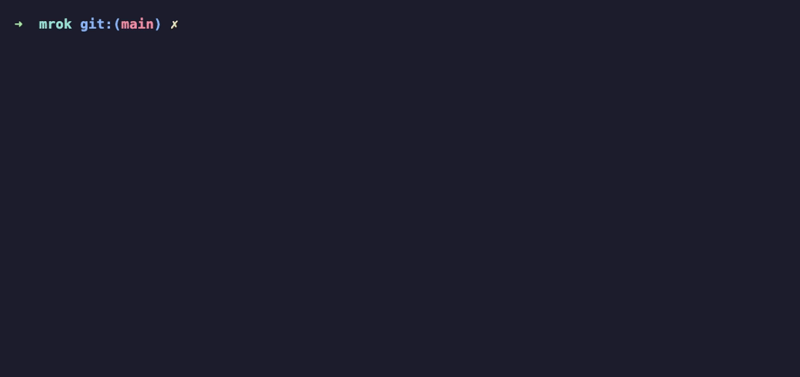

# mrok

**IDE-style, as-you-type suggestion popup for zsh and bash.** Pure shell script: no daemon,
no app, no account, works in any terminal (and over ssh).

<!--   (record with: vhs demo/demo.tape) -->

Type, and a list shows up right under the word you're typing. Pick with the arrow keys,
press Enter, and the next suggestions show up straight away: `cd` → sub-folders,
`git checkout` → branches with their last commit, `docker exec` → running containers,
`pnpm run` → the scripts in your `package.json`.

```
~/proj $ git checkout fe
                      feature/login   add login form
                      feature/search  search by name
```

- **Any terminal**: Terminal.app, iTerm2, WezTerm, Ghostty, Kitty, VS Code, Linux terminals, tmux, ssh
- **Pure shell**: a few files sourced from your rc file, nothing to compile, nothing running in the background
- **Your shell's own completion** (zsh compsys / bash-completion) plus ~690 command specs
  converted from [Fig](https://github.com/withfig/autocomplete) and a handful of plugins
- **Fuzzy matching**: prefix first, then substring, then the typed letters in order (`git chp` → `cherry-pick`)
- **Plugins are a few lines of shell**, and the same plugin works in zsh and bash

## Install

```sh
curl -fsSL https://raw.githubusercontent.com/bravo680git/mrok/main/install.sh | sh
```

or with wget:

```sh
wget -qO- https://raw.githubusercontent.com/bravo680git/mrok/main/install.sh | sh
```

Then open a new terminal. The installer copies mrok to `~/.mrok` and adds one block to
`~/.zshrc` and/or `~/.bashrc`:

```sh
# >>> mrok >>>
[ -f "$HOME/.mrok/mrok.sh" ] && . "$HOME/.mrok/mrok.sh"
# <<< mrok <<<
```

Keep that block at the **end** of the file (after oh-my-zsh / bash-completion are loaded).

Requirements: zsh 5.3+, or bash 4.3+. macOS still ships bash 3.2 (2007, the last GPLv2
version), so on a Mac use zsh (the default shell) or `brew install bash`.

From a clone: `git clone https://github.com/bravo680git/mrok && sh mrok/install.sh --local`

Only one shell: `... | sh -s -- --zsh` or `--bash`.

## Keys

| Key                                                                 | Action                                                |
| ------------------------------------------------------------------- | ----------------------------------------------------- |
| typing                                                              | popup appears / filters; the first row is preselected |
| `↑` `↓`                                                             | move the selection                                    |
| `Enter` / `Tab`                                                     | accept the selection, then show what comes next       |
| `Enter` with nothing selected, or when the word is already complete | run the command                                       |
| `Esc` (or `Ctrl-G` in bash)                                         | hide the popup                                        |
| `Tab` with the popup hidden                                         | open it                                               |

When the popup is hidden, the arrow keys, Enter and Tab behave exactly as before.

## Commands

```
mrok            help
mrok plugins    list commands that have a plugin
mrok update     update to the latest version
mrok uninstall  remove mrok and the block in your rc files
mrok spec       list installed Fig specs (also: available, add <cmd>, rm <cmd>, refresh)
```

## Configuration

Set these before the mrok block in your rc file:

| Variable                      | Default       |                                 |
| ----------------------------- | ------------- | ------------------------------- |
| `MROK_ROWS`                   | `8`           | max rows in the popup           |
| `MROK_BG` / `MROK_FG`         | `236` / `252` | popup background / text         |
| `MROK_DESC_FG`                | `244`         | description text                |
| `MROK_SEL_BG` / `MROK_SEL_FG` | `88` / `231`  | selected row (burgundy)         |
| `MROK_SEL_DESC_FG`            | `224`         | description on the selected row |
| `MROK_FOOT_FG`                | `242`         | the "3/42" footer               |
| `MROK_DEBUG`                  |               | file to write a debug log to    |

Colors are numbers from the [256-color palette](https://en.wikipedia.org/wiki/ANSI_escape_code#8-bit).

## Built-in plugins

| Commands                  | Suggests                                                                                              |
| ------------------------- | ----------------------------------------------------------------------------------------------------- |
| `npm` `pnpm` `yarn` `bun` | scripts from the nearest `package.json` (with the command they run), common commands                  |
| `git`                     | subcommands with descriptions, your git aliases, branches (with last commit), remotes, stash commands |
| `make`                    | Makefile targets; `target: ## text` becomes the description                                           |
| `docker` `docker-compose` | container names (running / stopped / all, by subcommand) with status and image, images, networks, volumes, contexts, compose services; the rest from the Fig spec |
| `mrok`                    | its own commands; spec names for `mrok spec add` / `rm`                                               |

Everything else comes from your shell's completion: folders for `cd`, files, options, etc.

## Command specs (from Fig)

mrok ships ~690 command specs converted from [withfig/autocomplete](https://github.com/withfig/autocomplete)
(`docker`, `kubectl`, `go`, `cargo`, `brew`, ...): subcommands, options and their values,
with descriptions. They are plain text files in `~/.mrok/specs/`, read with `awk` only when
you type that command.

- Every 3 days (`MROK_SPEC_REFRESH_DAYS`), a new shell refreshes the specs in the
  background: it deletes the specs of commands you don't have and downloads the ones of
  commands you installed since (from this GitHub repo; that's mrok's only network
  access, besides `mrok update`). So only what you use stays on disk. `mrok spec refresh`
  does it right away.
- `mrok spec add <cmd>` downloads one later (e.g. after installing a new tool),
  `mrok spec rm <cmd>` removes one and keeps it removed across updates.
- Parts that need JavaScript in Fig (e.g. container names for `docker exec`) aren't
  converted; mrok falls back to your shell's completion there. A built-in or user plugin
  for the same command always wins over the spec.

Maintainers regenerate the specs with `tools/fig/convert.mjs` (instructions at its top);
`tools/fig/DYNAMIC.md` lists what was not converted. The specs keep Fig's MIT license,
see `specs/LICENSE`.

## Writing a plugin

Put a file in `~/.config/mrok/plugins/` (any name ending in `.sh`). Example: suggest the
recipes of a [`just`](https://github.com/casey/just) file.

```sh
# ~/.config/mrok/plugins/just.sh
mrok_register my_just just

my_just() {
  # "$@" = words typed before the current one ($1 is the command)
  # $MROK_CUR = the word being typed
  [ $# -eq 1 ] || return 1                       # 1 = not mine, use normal completion
  case $MROK_CUR in -*) return 1 ;; esac
  just --summary 2>/dev/null | tr ' ' '\n' | while read -r r; do
    printf '%s\t%s\n' "$r" recipe              # value<TAB>description
  done
  return 0                                       # 0 = use what I printed
}
```

The rules:

- `mrok_register <function> <command>...` attaches the function to one or more commands.
- The function receives the words **before** the one being typed: `pnpm run d` calls it
  with `pnpm run`, and `MROK_CUR=d`.
- Print one suggestion per line: `value` or `value<TAB>description`. Print everything,
  mrok does the filtering (prefix first, then substring, then fuzzy, case-insensitive).
- A value ending with `/` or `=` is inserted without a trailing space.
- Return `0` to use your output (no output = no popup), `1` to fall back to the shell's
  completion.
- The output is cached while the user types the same word, so calling `git`, `node`,
  `docker` is fine.
- The plugin is sourced in both zsh and bash: stick to plain `sh`-style syntax
  (`[ ]`, `case`, `$#`, no arrays).

Helpers you can use: `mrok_find_up <file>` (nearest file walking up from `$PWD`),
`mrok_pkg_scripts`, `mrok_git_branches`, and for a command that has a spec,
`__mrok_spec_where <cmd> "$@"` (which subcommand / argument is being typed, see
`plugins/docker.sh`) and `__mrok_spec <cmd> "$@"` (the spec's own suggestions). A plugin
with the same command name as a built-in one replaces it.

## How it works

- **zsh**: a zle widget runs after every keystroke, calls zsh's completion system with a
  wrapped `compadd` to collect matches (instead of showing zsh's menu), and draws the popup
  with `POSTDISPLAY` + `region_highlight`.
- **bash**: printable keys are bound to readline macros (insert the character, then call a
  `bind -x` hook). The popup is drawn with ANSI escape codes below the prompt. Candidates
  come from the command's `complete -F` function (bash-completion), `compgen`, and plugins.

## Limitations

- The popup is drawn with text, under the command line, not as a floating window.
- bash: emacs editing mode only; non-ASCII typing doesn't refresh the popup.
- After `Ctrl-C` a few blank lines can be left where the popup was.
- bash: after `Ctrl-L` the popup comes back only once the suggestions change.

## Uninstall

```sh
mrok uninstall
```

## Contributing

Issues and PRs welcome, especially plugins for commands you use every day. Set
`MROK_DEBUG=/tmp/mrok.log` to see what mrok computes on each key. The demo GIF is
recorded with [vhs](https://github.com/charmbracelet/vhs): `vhs demo/demo.tape`.

## License

MIT. The files in `specs/` are generated from Fig's autocomplete specs, MIT licensed,
copyright (c) 2021 Hercules Labs Inc. (Fig): see `specs/LICENSE`.
